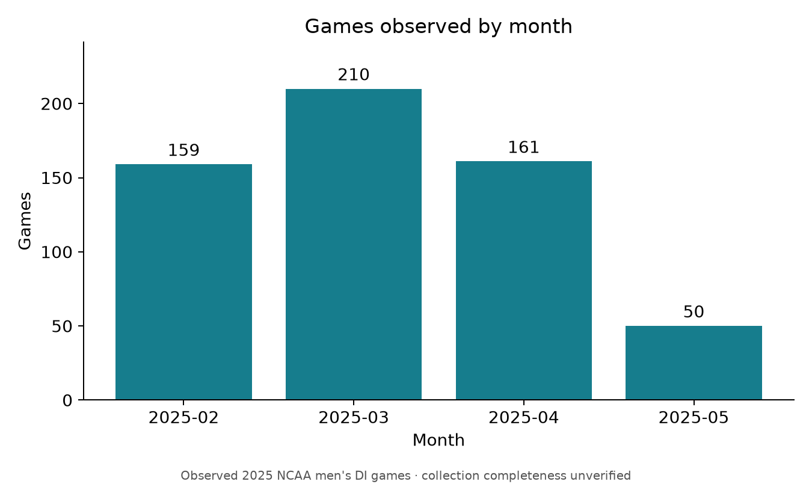
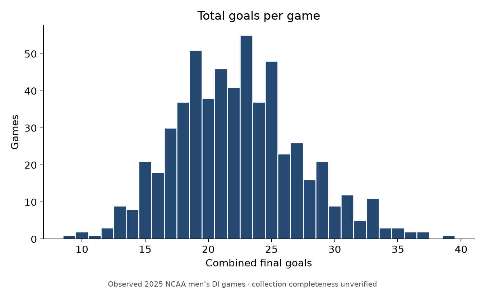
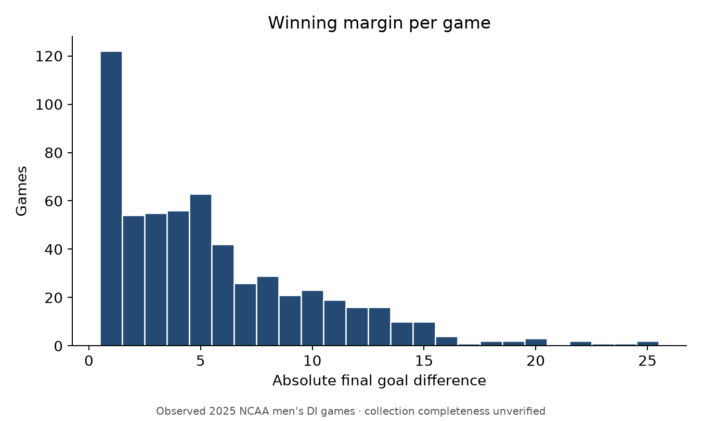
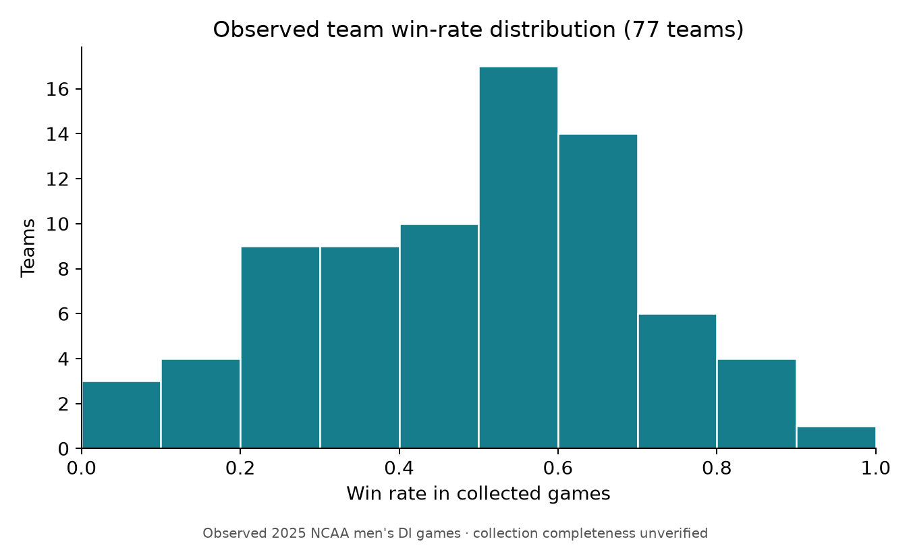
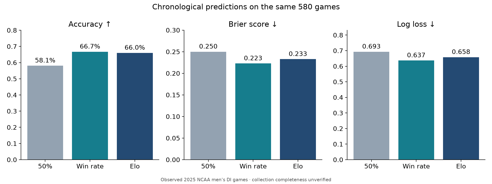

# Preliminary NCAA men's Division I lacrosse modeling: 2025

Generated: 2026-11-10T10:26:59-05:00. This is a retrospective chronological backtest of the **observed collection**, whose full-season completeness remains unverified. It uses only `data/processed/lacrosse_games_2025.csv`; no odds or additional sports data were collected or used.

## Data inspected

The source contains **580 completed games, 34 columns and 77 distinct team slugs**, dated **2025-02-01 through 2025-05-26**. There are 0 duplicated game IDs and 0 duplicated complete rows, no duplicate unordered same-date matchups, no tied finals, and no missing/invalid final scores or winners. All 580 source records are retained; **0 exclusions**. Teams have 12–19 observed games each. These counts describe the collection, not verified complete schedules or independently verified Division I membership of every opponent.

The existing [validation report](games_2025_validation.md) marks collection status INCOMPLETE and season completeness NOT_VERIFIED: 81 of 181 requested dates returned verified JSON; 100 failed or unchecked dates remain. A failed date is not evidence that no games occurred. No new collection or completeness investigation was performed for this task.

Complete source column list: `game_id`, `season`, `game_date`, `game_datetime_utc`, `home_team`, `away_team`, `home_team_id`, `away_team_id`, `home_score`, `away_score`, `winner`, `game_status`, `neutral_site`, `venue`, `postseason`, `source_name`, `source_url`, `home_team_slug`, `away_team_slug`, `home_team_code`, `away_team_code`, `home_winner_flag`, `away_winner_flag`, `bracket_round`, `bracket_id`, `final_message`, `current_period`, `overtime`, `start_time_text`, `start_time_epoch_raw`, `home_score_raw`, `away_score_raw`, `invalid_score_format`, `game_page_url`.

| Month | Observed games |
| --- | ---: |
| 2025-02 | 159 |
| 2025-03 | 210 |
| 2025-04 | 161 |
| 2025-05 | 50 |

Home-designated teams won 337 games and away-designated teams won 243. Home designation follows the source; actual home advantage cannot be verified because venue/neutral-site metadata is absent. Mean combined goals: 22.324; median: 22.0; range: 9–39. Mean winning margin: 5.645; range: 1–25 goals. These are descriptive final-result statistics, never pre-game inputs.

### Source missing values

There are 4572 missing source cells. Columns omitted from this table have zero missing values.

| Source column | Missing cells |
| --- | ---: |
| `game_datetime_utc` | 563 |
| `home_team_id` | 580 |
| `away_team_id` | 580 |
| `neutral_site` | 580 |
| `venue` | 580 |
| `postseason` | 563 |
| `bracket_round` | 563 |
| `bracket_id` | 563 |

### Schedule ambiguity retained

The source assigns Binghamton two different games on April 5, 2025, without reliable start times: game `6312399` (Binghamton 9–11 UAlbany) and `6371921` (UMBC 17–7 Binghamton). Their IDs and opponents differ, so they are not duplicate game records. Both are retained unchanged and flagged here as a possible source date/schedule issue requiring later verification. Neither game can inform the other's features. Historical counts and later predictions necessarily inherit this unresolved source issue.

## Pre-game feature dataset

[`lacrosse_model_features_2025.csv`](../data/processed/lacrosse_model_features_2025.csv) contains 580 rows and 68 columns: **45 numeric predictors**, 6 label columns, and 17 metadata columns. The [machine-readable schema](model_feature_schema_2025.json) explicitly lists these three roles. Always select `feature_columns` from the schema for any later model; do not select every numeric column.

Every feature below is calculated for both teams (`home_`, `away_`) and as the home-minus-away difference (`diff_`), giving 15 × 3 = 45 predictors. Historical means/counts refer only to games available in this collection, not an assumed complete season.

| Team feature suffix | Definition using strictly earlier dates | No previous games |
| --- | --- | --- |
| `previous_games_played` | Count of observed prior games | 0 |
| `previous_wins` | Observed prior wins | 0 |
| `previous_losses` | Prior games minus prior wins | 0 |
| `previous_win_pct` | Prior wins / prior games | 0.5 |
| `smoothed_win_pct` | (Prior wins + 1) / (prior games + 2) | 0.5 |
| `avg_goals_scored` | Prior goals scored / prior games | 0 placeholder |
| `avg_goals_conceded` | Prior goals conceded / prior games | 0 placeholder |
| `avg_goal_difference` | Prior (scored − conceded) / prior games | 0 placeholder |
| `wins_last_five` | Wins in up to five most recent prior games | 0 |
| `last_five_games_played` | Size of recent window, at most five | 0 |
| `days_since_previous_game` | Calendar days from latest observed prior game | 0 placeholder |
| `no_history` | 1 when no observed prior games, otherwise 0 | 1 |
| `rest_days_missing` | 1 when no prior game date exists, otherwise 0 | 1 |
| `last_five_order_ambiguous` | 1 if unknown same-day order prevents an exact five-game count | 0 |
| `pregame_elo` | Elo rating from strictly earlier dates | 1500 |

Zero goal/rest placeholders do not claim a team actually scored zero goals or had zero rest. Their indicators distinguish unavailable history. No full-season averages or future records are used for initialization. There are 38 home-team first appearances, 39 away-team first appearances, and 24 games where both teams have no observed history.

All games on one source calendar date are predicted before updating **any** histories or Elo ratings for that date. This deliberately conservative policy also applies to the 17 records with populated UTC start times. We do not invent an order for the other 563. When a five-game history boundary cuts a group of mixed win/loss outcomes on an unknown-order date, `wins_last_five` uses a zero placeholder with `last_five_order_ambiguous=1`; a uniform-outcome boundary still has an exact count. There are 0 such ambiguous team-feature occurrences in this actual output. This policy is tested even when the observed count is zero.

NCAA `game_id`, team names, team slugs, original team codes/IDs, source URLs and game-page URL are preserved for later joins. Numeric team IDs remain null; slugs and codes are available. `home_history_last_date` and `away_history_last_date` expose the latest allowed history date for auditing. `game_date` is the source date, not a reconstructed timezone conversion. Labels are `actual_winner`, `home_score`, `away_score`, `label_home_win`, `label_total_goals`, and `label_winning_margin`. Final scores, winner flags, overtime and season-end summaries never enter predictive features.

The 45 predictors have **0 missing cells** and are finite. Remaining output nulls are metadata, not silently imputed observations:

| Feature-file metadata | Missing cells |
| --- | ---: |
| `game_datetime_utc` | 563 |
| `home_team_id` | 580 |
| `away_team_id` | 580 |
| `home_history_last_date` | 38 |
| `away_history_last_date` | 39 |

## Fixed models and chronological evaluation

All three models predict a home-win probability and are evaluated on exactly the same **580 games**. Early-season games, including both-team first appearances, are included. This is expanding-history / prequential evaluation: predict the next date, reveal its results, then update state for subsequent dates. It is not a random split, a fitted in-sample regression, or an independently held-out season. No parameters are tuned, optimized, or selected using evaluation outcomes; all constants below were fixed before evaluation.

1. **Constant 50%:** `p(home win) = 0.5` for every game.
2. **Smoothed previous win percentage:** team strength `s = (W + 1) / (G + 2)` with fixed Laplace smoothing alpha = 1. Matchup probability `p(home win) = s_home / (s_home + s_away)`. This simple normalized-strength rule is not a calibrated probability estimate and ignores schedule strength.
3. **Elo:** each team begins at 1500. `E_home = 1 / (1 + 10 ** ((R_away - R_home) / 400))`. After the date is predicted, each game's home increment is `20 × (y_home - E_home)`, and its away increment is the negative. `y_home` equals 1 for a home win, 0 for an away win. All expectations use pre-date ratings. A team's multiple same-day increments are summed and applied together. K = 20; no home bonus, margin-of-victory adjustment, or season-end reset is used. Final rating sum is 115500.000000, conserving 1500 × 77.

For classification, **all models choose the home-designated team when p ≥ 0.5**, including exact ties. Therefore the 50% probability baseline's accuracy equals the observed home-win share, not 50%. We do not fit a home-advantage parameter from the complete season.

| Model | Games evaluated | Accuracy | Brier score | Log loss |
| --- | ---: | ---: | ---: | ---: |
| Constant 50% | 580 | 58.1034% | 0.250000 | 0.693147 |
| Smoothed win rate | 580 | 66.7241% | 0.222749 | 0.636925 |
| Elo | 580 | 66.0345% | 0.232781 | 0.658265 |

The best observed accuracy is Smoothed win rate (66.72%); the lowest Brier score is Smoothed win rate (0.222749), and the lowest log loss is Smoothed win rate (0.636925). These comparisons describe this run only. Elo's fixed K=20 produces relatively conservative probabilities; no attempt was made to adjust K after seeing the results.

Brier score is mean `(p − y)²`. Log loss is mean `−[y ln(p) + (1−y) ln(1−p)]` using natural logs (numerical clipping at 1e−15 only inside log loss). Lower Brier/log loss is better; higher accuracy is better. The constant baseline has Brier 0.25 and log loss ln(2). Full-precision results are in [the metrics CSV](preliminary_model_metrics_2025.csv), and individual probabilities are in [the predictions CSV](../data/processed/lacrosse_predictions_2025.csv).

| Model | Minimum home probability | Maximum home probability | Exact 0.5 probabilities |
| --- | ---: | ---: | ---: |
| Constant 50% | 0.500000 | 0.500000 | 580 |
| Smoothed win rate | 0.098592 | 0.889831 | 61 |
| Elo | 0.303212 | 0.699318 | 26 |

These results compare simple methods on one observed season. Team-strength methods gain history as the season progresses, while early-season predictions begin with no prior-year knowledge. Accuracy alone does not assess probability calibration; Brier and log loss add evidence about probability quality. Differences in these point estimates are not claims of statistical significance, profitability, or future-season generalization.

## Figures











`team_season_descriptive_2025.csv` contains the full observed-season summaries used for the team win-rate figure. It is descriptive output only and must not be joined as pre-game features.

## Limitations and missing information

- NCAA collection completeness is unverified. Missing games bias prior counts, strengths, recent form and apparent rest days. First observed appearance does not necessarily mean first actual game of the season.
- The Binghamton April 5 schedule ambiguity remains unresolved. No uncertain source date was corrected or record removed.
- This is only a **2025 season backtest** with no independent future-season test, uncertainty intervals, calibrated probabilities or parameter tuning.
- Historical sportsbook odds are **not yet available for this modeling analysis**; no odds file is read, joined, searched or collected. No sportsbook comparison, expected value or betting-return claim is possible.
- The existing **2022–2023 team-season aggregate dataset is not used as 2025 pre-game data**. No other dataset or sport supplies features.
- Most start times, all numeric team IDs, and all venue/neutral-site fields are missing. Exact within-day ordering and true home advantage cannot be established. Source slugs supply team identity, without external alias matching.
- Final results are assumed available on subsequent source dates; the CSV does not contain timestamped evidence of when each result was first published or whether a source date was later revised. This is a date-based historical simulation, not a recreation of archived live information feeds.
- Models predict win/loss only, using the requested elementary baselines. Scores and total-goal/margin distributions are descriptive labels, not fitted score forecasts.

## Reproduction and verification

Use the existing `dsf-lacrosse` Conda environment (Python 3.11); do not create a new environment. From the repository root:

```bash
conda activate dsf-lacrosse
python -c "import sys; print(sys.executable); print(sys.version)"
python -m pip install -r requirements-modeling.txt
python src/model_lacrosse.py
python -m pytest -q
python -m pip check
```

`requirements-modeling.txt` captures the environment including matplotlib for local plots. The existing README and requirements file are preserved. Rerunning the script makes no network requests and regenerates only this task's derived artifacts. It checks all protected input hashes before writing outputs. Report generation time changes on reruns; feature/prediction CSV content is deterministic.

Source SHA-256: `79b43ec0168d5466d29a0e3be2c7a9bb46096038aefc25a54f70b2e0b24393a3`. Feature CSV SHA-256: `d72ccb81d43c2d6c81cfb21a3cfb9888ca351eca5de4a73fced7cfd8dcb344d2`. Predictions CSV SHA-256: `23c2a0d629485cfa0af980676618cd3b84c693ef8f521e81cd0ceef5e40cf563`. All files in [the pre-run protected-input manifest](modeling_2025_original_checksums.json) were unchanged after generation: **True**. This includes all pre-existing raw/processed data files and the original validation documents.

`tests/test_model_lacrosse.py` verifies independent prior-date histories, prefix-only runs, future/own-result mutation invariance, same-day isolation using the actual repeated-team records, Elo updates/conservation, cold-start handling, duplicate rejection, bounded probabilities and complete accounting of all 580 IDs. Counterfactual score changes exist only inside tests and are never saved as data. See [the verification record](modeling_2025_verification.json) for executed commands, test results and final artifact checks.

New artifacts: the feature and prediction CSVs; `src/model_lacrosse.py`; `src/modeling_report.py`; `tests/test_model_lacrosse.py`; `requirements-modeling.txt`; this report; the metrics, descriptive team summary, feature schema, modeling summary, original-checksum manifest and verification record; and the five PNG figures above. No source datasets are modified.
